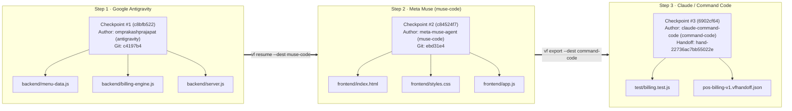

# 🍽️ BistroForce POS — Restaurant Billing Center (Powered by VectorForce)

A simplified, zero-database **Restaurant Ordering & Billing Center** built step-by-step across **Google Antigravity**, **Meta Muse (`Muse Spark Open`)**, and **Claude Code / Command Code** to demonstrate how **[VectorForce](https://github.com/getvectorforce/VectorForce)** preserves engineering context, architectural decisions, and non-negotiable constraints across AI coding tools.

---

## 🧠 VectorForce Studio — Engineering Intelligence Dashboard

When you run `vf studio` inside this workspace (`http://127.0.0.1:3210`), **VectorForce Studio** visualizes the complete multi-agent topology, code dependency graph, and chronological decision ledger recorded in `.vectorforce/vectorforce.db`.

```text
┌──────────────────────────────────────────────────────────────────────────────────────────┐
│  VECTORFORCE STUDIO · WORKSPACE CONTROL CENTER                      [SQLite WAL: ACTIVE] │
│  Project: Restaurant Billing Center (proj-b008d3b8a1dd63d9)         Drift Status: 0%     │
├─────────────────────────┬──────────────────────────┬──────────────────┬──────────────────┤
│  ACTIVE TASK            │  IMMUTABLE CHECKPOINTS   │  DECISIONS MADE  │  SIGNED HANDOFFS │
│  1 (pos-billing-v1)     │  3 Committed             │  7 Architectural │  1 Verified      │
│  Status: ACTIVE         │  Harnesses: 3 IDEs/CLIs  │  Constraints: 4  │  HMAC-SHA256     │
└─────────────────────────┴──────────────────────────┴──────────────────┴──────────────────┘
```

### 1. Cross-Harness Continuity & Code Topology Graph



---

### 2. Decision Intelligence Ledger (What Was Decided & Who Made It)

Every architectural choice in this project was captured as a structured **VectorForce Decision** tied to a cryptographic Git commit SHA and allowlisted document digest (`AGENTS.md`, `ARCHITECTURE.md`):

| Decision ID | Decision Title | Architectural Rationale | Who Made It (Author & Harness) | Checkpoint ID | Git Commit |
| :--- | :--- | :--- | :--- | :--- | :--- |
| **`DEC-BILL-01`** | **InMemoryBillStore** | Store menu catalog and issued invoices (`INV-1001`) in memory with zero external database dependencies. | `omprakashprajapat` via **Google Antigravity** (`antigravity`) | `c8bfb522` | `c4197b4` |
| **`DEC-BILL-02`** | **IntegerCentMath** | Convert all dollar prices to integer cents before applying promo discounts and 5% GST to prevent IEEE-754 floating-point drift. | `omprakashprajapat` via **Google Antigravity** (`antigravity`) | `c8bfb522` | `c4197b4` |
| **`DEC-BILL-03`** | **UnifiedPort4000** | Serve both `/api/*` REST routes and static `frontend/` assets from `backend/server.js` on port `4000`. | `omprakashprajapat` via **Google Antigravity** (`antigravity`) | `c8bfb522` | `c4197b4` |
| **`DEC-POS-01`** | **ServerAuthoritativePreview** | Frontend never duplicates tax or promo rounding logic in browser JS; every cart change queries `POST /api/bills/preview`. | `meta-muse-agent` via **Meta Muse** (`muse-code`) | `c84524f7` | `ebd31e4` |
| **`DEC-POS-02`** | **ThermalReceiptModal** | Render a printable courier-font tax invoice modal (`INV-1001`) on checkout and live-update the topbar revenue KPIs. | `meta-muse-agent` via **Meta Muse** (`muse-code`) | `c84524f7` | `ebd31e4` |
| **`DEC-QA-01`** | **SignedHandoffVerification** | Export HMAC-SHA256 signed handoff bundle (`pos-billing-v1.vfhandoff.json`) for zero-trust QA/production review. | `claude-command-code` via **Command Code** (`command-code`) | `6902cf64` | `ebd31e4` |
| **`DEC-QA-02`** | **E2EServerContractTest** | Verify `/api/menu`, `/api/bills`, and static POS HTML delivery via automated Node test runner. | `claude-command-code` via **Command Code** (`command-code`) | `6902cf64` | `ebd31e4` |

---

### 3. Invariant Constraints Enforced Across All IDEs

When switching from **Google Antigravity** (Step 1) to **Meta Muse** (Step 2) and **Command Code** (Step 3), VectorForce injected these non-negotiable constraints into every resume briefing (`vf resume --task pos-billing-v1`):

1. ⚠️ **Zero external database dependencies** (use pure in-memory store).
2. ⚠️ **All currency calculations must use integer-cent math** to prevent floating-point rounding drift.
3. ⚠️ **5% GST tax must be applied after promo code discounts**.
4. ⚠️ **Frontend must never duplicate tax/discount rounding math**; always use `POST /api/bills/preview`.

> **Why this matters:** Without VectorForce, a second AI agent building the frontend in Step 2 typically writes its own `subtotal * 1.05` math in `frontend/app.js`, causing 1-cent rounding mismatches between the cart preview and the backend invoice. Because VectorForce carried `DEC-BILL-02` and the invariant constraints into Step 2, the frontend agent delegated 100% of bill calculations to `POST /api/bills/preview`.

---

## 🚀 Quickstart: Run the POS App & VectorForce Studio

### 1. Start the Restaurant Billing Center (`http://127.0.0.1:4000`)
```bash
npm start
# Open http://127.0.0.1:4000 in your browser
```

### 2. Run the Automated Unit & E2E Tests
```bash
npm test
```

### 3. Inspect Context & Launch VectorForce Studio (`http://127.0.0.1:3210`)
```bash
# Check workspace & MCP harness status
vf status

# View the chronological multi-IDE engineering recap
vf recap

# Generate an AI reasoning briefing (using Meta Muse Spark Open, Ollama, OpenRouter, etc.)
vf reason --task pos-billing-v1

# Launch VectorForce Studio visual dashboard
vf studio
```

---

## 📁 Project Structure

```text
Restaurantbiling/
├── AGENTS.md                        # VectorForce agent protocol rules (allowlisted)
├── ARCHITECTURE.md                  # System boundaries & REST API spec (allowlisted)
├── README.md                        # Studio dashboard & decision lineage showcase
├── package.json                     # Scripts for POS server, tests, and VectorForce CLI
├── pos-billing-v1.vfhandoff.json    # HMAC-SHA256 signed cross-IDE handoff package
├── backend/
│   ├── menu-data.js                 # Curated menu items & promo codes (WELCOME10, FEAST20, FLAT5)
│   ├── billing-engine.js            # Integer-cent billing engine & in-memory invoice ledger
│   └── server.js                    # Zero-dependency Node.js HTTP server (port 4000)
├── frontend/
│   ├── index.html                   # BistroForce POS ordering interface & receipt modal
│   ├── styles.css                   # Responsive dark-slate & amber POS styling
│   └── app.js                       # Server-authoritative POS cart & invoice controller
└── test/
    └── billing.test.js              # Unit & live HTTP E2E test suite (4/4 passing)
```
