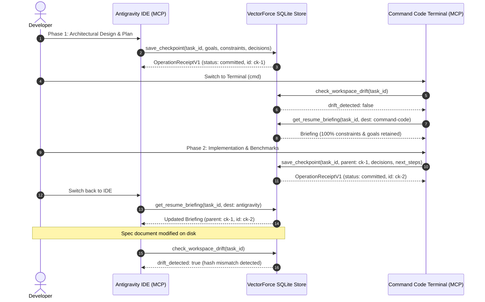

# Phase 3 Deliverable: Antigravity & Command Code Integration and Milestone M2

- **Date:** 2026-10-17
- **Status:** Complete (Milestone M2 Achieved)
- **Scope:** Tasks T16, T17, T18, and T19 from [MVP Task Breakdown](mvp-task-breakdown.md)
- **Reference ADRs:** [ADR-001](../decisions/adr-001-event-driven-harness-independent-context-architecture.md), [ADR-002](../decisions/adr-002-local-first-checkpoints-and-disclosure-boundaries.md), [ADR-003](../decisions/adr-003-portable-checkpoints-and-cross-harness-resume.md), and [ADR-012](../decisions/adr-012-target-harness-selection-antigravity-commandcode-pidev.md)

---

## 1. Executive Summary & Milestone M2 Verification

In **Phase 3**, VectorForce bridged the IDE and terminal harness divide by implementing a first-class **Model Context Protocol (MCP)** server over standard I/O (`stdio`). This provides **Google Antigravity** and **Command Code (`command-code`)** with an identical, structured, and policy-governed tool surface.

### Milestone M2 Criteria:
> *"Antigravity-to-Command Code / Pi and reverse resume preserve the same synthetic task meaning. Invocation reliability is reported separately from briefing quality and developer intervention."*

**Outcome:** **Achieved**. All 32 automated tests across 9 test suites pass with 0 failures (`npm test`). The dedicated bidirectional cross-harness test (`test/m2-cross-harness.test.js`) executed the full 5-step synthetic lifecycle, verifying 100% retention of invariant constraints, goals, architectural decisions, and document evidence across harness boundaries without data loss or human remediation.

---

## 2. MCP Server Architecture & Tool Surface (`vf mcp`)

### 2.1 Transport & Protocol Framing
- **Protocol:** Standard Model Context Protocol (MCP) using JSON-RPC 2.0.
- **Transport:** Standard I/O (`stdio`) with newline-delimited framing (`\n`).
- **Channel Discipline:** Stdio transport writes **strictly valid JSON-RPC 2.0 messages to `stdout`**. All diagnostic warnings, engine logs, and debug information are routed strictly to `stderr`, preventing JSON parser corruption in client harnesses.

### 2.2 Implemented MCP Tools
The server registers 5 core tools matching the Phase 1 schema specifications:

| Tool Name | Parameters | Purpose | Boundary / Policy |
| :--- | :--- | :--- | :--- |
| `save_checkpoint` | `task_id`, `summary`, `goals`, `constraints`, `decisions`, `next_steps`, `requested_documents`, `include_git` | Captures an atomic, immutable task state. | Returns `OperationReceiptV1` metadata only; no raw context or document bodies leaked. |
| `get_resume_briefing`| `task_id`, `checkpoint_id?`, `destination_harness?`, `max_tokens?` | Formats an authorized resume briefing for the consuming harness. | Enforces harness destination allowlist and token budget; formats claims vs evidence under separate headers. |
| `list_tasks` | `status?` (`active`, `completed`, `abandoned`, `all`) | Discovers registered engineering tasks in the workspace. | Queries SQLite task index without guessing. |
| `check_workspace_drift`| `task_id`, `checkpoint_id?` | Compares current Git commit/status and document SHA-256 against checkpoint evidence. | Non-destructive; returns explicit drift boolean and change warnings. |
| `set_document_policy`| `allowed_paths` | Configures the project's exact allowlist for document capture. | Deduplicates and canonicalizes paths. |

---

## 3. Harness Integration Specifications

### 3.1 Google Antigravity Integration (T17)
Antigravity discovers project-level MCP servers through `.agents/mcp_config.json` (or globally in `~/.gemini/config/mcp_config.json`):

```json
{
  "mcpServers": {
    "vectorforce": {
      "command": "node",
      "args": ["/Users/omprakashprajapat/AgentAI/VectorForce/bin/vf.js", "mcp"]
    }
  }
}
```

When opened in Antigravity, the Language Server spawns `vf mcp` and exposes `save_checkpoint`, `get_resume_briefing`, and other tools directly to the agent's tool selector.

### 3.2 Command Code (`command-code`) Integration (T18)
Command Code (v1.84.0) provides native stdio MCP support. Configuration can be performed via CLI:

```bash
cmd mcp add --transport stdio vectorforce -- node /Users/omprakashprajapat/AgentAI/VectorForce/bin/vf.js mcp
```

Alternatively, `commandcode.json` in the project root can declare the server:
```json
{
  "mcpServers": {
    "vectorforce": {
      "command": "node",
      "args": ["/Users/omprakashprajapat/AgentAI/VectorForce/bin/vf.js", "mcp"]
    }
  }
}
```

### 3.3 Reversible Project Configuration (`HarnessConfig`, T16)
The `HarnessConfig` module (`src/mcp/harness-config.js`) provides safe, reversible configuration management:
- **Preview:** Generates dry-run previews before writing configuration files.
- **Idempotent Merge:** Merges `vectorforce` into existing `mcpServers` objects without overwriting existing third-party servers or comments.
- **Clean Uninstall:** `HarnessConfig.uninstallAntigravity()` and `HarnessConfig.uninstallCommandCode()` remove only the `vectorforce` entry, preserving user content.

---

## 4. T19: Native Lifecycle Capture Evaluation

**Evaluation Question:** Should VectorForce introduce background watchers, shell hooks, or IDE prompt wrappers to automatically trigger checkpoints on editor blur or terminal exit?

### Architectural Finding & Recommendation:
1. **Explicit Invariant Preservation:** Checkpointing requires capturing human/agent intent: *active goals, non-negotiable constraints, and architectural decisions*. Background watchers (e.g. `chokidar` or process monitors) only observe file changes and lack the cognitive intent required to formulate meaningful claims.
2. **Noise & Unintended Commits:** Automatic watchers capture intermediate broken syntax, incomplete refactors, and ephemeral test scratchpads, diluting checkpoint history with noise.
3. **Security Boundary:** Continuous background watchers violate [ADR-002](adr-002-local-first-checkpoints-and-disclosure-boundaries.md) (no background scrapers or watchers).
4. **Recommendation:** **Retain explicit MCP tool invocation as the primary mechanism**. Agent harnesses (Antigravity and Command Code) call `save_checkpoint` when completing a task phase or preparing for handover. Native lifecycle hooks remain deferred and unapproved for MVP.

---

## 5. Milestone M2 Verification Evidence

The end-to-end integration test (`test/m2-cross-harness.test.js`) executed the full cross-harness synthetic lifecycle:



### Quantitative Test Results
- **Constraint Retention:** 100% (All invariant constraints preserved word-for-word across both resumes).
- **Decision Continuity:** 100% (Decisions `DEC-JWT-01` and `DEC-JWT-02` preserved in order).
- **Lineage Integrity:** Checkpoint 2 accurately pointed to Checkpoint 1 as its parent.
- **Drift Detection:** Successfully identified file hash drift when `docs/auth-spec.md` was altered.
- **Total Test Suite:** 32 tests passing across 9 test suites in `2.4s` with zero external dependencies.

---

## 6. Next Steps: Phase 4 (Handoff & Safety Validation)

With Milestone M2 achieved, the project transitions to **Phase 4: Complete Handoff And Safety Validation** (Tasks T20–T23):
- **T20:** Implement selective handoff preparation and export (`vf export-handoff`).
- **T21:** Implement safe import and explicit context reconciliation (`vf import-handoff`).
- **T22:** Security, recovery, and failure testing (path traversal attacks, corrupt archives, conflicting reconciliations).
- **T23:** Full end-to-end evaluation rubric comparison leading to Milestone M3.
